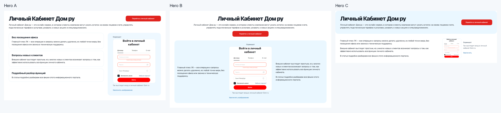

# Личный кабинет: три дополнительных варианта первого экрана

4 ноября 2026. [Задача #497](https://github.com/Celtoman/astro-telekom/issues/497), продолжение [вариантов блоков #494](2026-11-04-account-block-options-figma.md). Статус: **CANDIDATE / UNPUBLISHED**. Выбор владельца ещё не получен.

[Сравнение в Figma: исходный + A/B/C](https://www.figma.com/design/AcPPCDVqYqZIUJ0GXZVlHj?node-id=101-29), [новый раздел общей страницы выбора](https://www.figma.com/design/AcPPCDVqYqZIUJ0GXZVlHj?node-id=102-5). Созданы именно три дополнительных варианта; текущий первый экран сохранён отдельно и представлен слева связанными экземплярами. Итоговая страница не собиралась.

## Обоснование и варианты

Владелец расширил выбор: первый экран тоже должен иметь ещё три разные композиции. Цель остаётся прежней: узнать назначение страницы и быстро перейти в официальный кабинет либо продолжить чтение руководства. Полная исходная копия сохраняется; авторизация на партнёрской странице не имитируется.

Три независимых автора design_a, design_b и design_c применили product-design-and-ux, impeccable, interaction-design, web-accessibility, design-critique, ux-audit, emil-design-eng и Figma-навыки. Координатор изучил и повторно экспортировал действующие [HOME Hero43:210](https://www.figma.com/design/yMIEwjHa3SW9IkK26bMc6Y?node-id=43-210), [CITY Hero12:189](https://www.figma.com/design/wTUEawOZ8dTBwgzQSad8hw?node-id=12-189) и исходный ACCOUNT13:126. Их визуальные материалы просмотрены авторами. Использованы белая основа, спокойные голубые поверхности, системные контуры и существующие связанные действия; содержимое HOME/CITY не переносилось.

| Вариант | Композиция и действие | Компромисс |
|---|---|---|
| [A · Сначала вход](https://www.figma.com/design/AcPPCDVqYqZIUJ0GXZVlHj?node-id=97-5) | Белая верхняя строка H1/кнопки; три смысловые панели и отдельная зона скриншота. На Mobile кнопка сразу после H1. | Самый высокий мобильный вариант; на Tablet свободное место под изображением. |
| [B · Вход над центральным снимком](https://www.figma.com/design/AcPPCDVqYqZIUJ0GXZVlHj?node-id=97-121) | H1/lead/кнопка над центральным скриншотом, пояснения окружают его на Desktop. | Изображение лучше заметно, общая высота больше. |
| [C · Голубой вход и нейтральная справка](https://www.figma.com/design/AcPPCDVqYqZIUJ0GXZVlHj?node-id=99-21) | Голубая полоса основного перехода, затем белая справка с контекстным превью. | Превью160/120/96px не предназначено для чтения полей; полный снимок доступен отдельно. |

Desktop-высоты A/B/C приблизительно755/819/440px. Это разные композиции и порядок восприятия, а не только смена цвета. На общей странице выбора теперь48 новых кандидатов16 блоков; исходный первый экран остаётся дополнительным сохранённым ориентиром.

## Содержание, библиотека и поведение

Сохранены7 фрагментов widgets0–4: H1, четыре полных абзаца, исходная подпись и кнопка «Перейти в личный кабинет», а также изображение0 с исходными пропорциями и imageHash. Дополнительные заголовки A лишь группируют сохранённые абзацы; справочные части не обозначаются обязательными шагами. Боковое оглавление не добавлено; отдельный блок чипов остаётся следующим кандидатом страницы.

Использованы действующие Geist-стили и переменные общей [UI Library](https://www.figma.com/design/PiSCXYR88uqqcS6tKVfd8T), связанные primary button и text-action. Новых глобальных токенов, изменённых библиотечных masters и публикации нет. Композиции локальные, редактируемые, с Auto Layout и Hug/Fill.

H1 наследует числовое оформление текущего ACCOUNT: Heading/Page/Desktop48/50, Tablet40/43, Mobile28/33; основной текст16/24, подпись14/20. Проверены и выбранная роль, и фактические style keys/fontSize/lineHeight во всех12 оригиналах. Это сохранение действующего ACCOUNT, не распространение специального правила HOME на все страницы.

Primary48px настроен на исходный URL https://dom.ru/user/login; в Figma реакции открывают URL в новой вкладке. «Увеличить» ведёт к исходному файлу изображения. В каждом варианте изображение явно помечено «Скриншот»; внутри него нет действующих полей нашей страницы. Реальные внешние переходы, авторизация, Tab/фокус и работа AT в этой статической поставке не тестировались. В реализации нужны нативная ссылка, видимый focus и понятный alt; ошибки авторизации принадлежат внешнему сервису, а не локальному hero.

## Проверки и доработка

[Проверка12 оригиналов](evidence/2026-11-04-account-hero-options/audit.json):84 сравнения обязательных фрагментов,12 проверок изображения, все12 привязок H1 к ожидаемым стилям, первичные URL и высота48px. Пропусков, горизонтальных/вертикальных выходов и длинного фиксированного текста не зарегистрировано. Минимальный контраст редактируемого текста —4.74:1; это расчёт текущих сплошных цветов макета, без оценки текста внутри исходного растра.

В первом рендере общий координаторский tail ошибочно применил оформление ссылки к подписи импортированной primary-кнопки. Восстановлены белый цвет и отсутствие подчёркивания из master; URL-реакция сохранена. Все восемь затронутых экземпляров A/B исправлены, PNG перезаписаны, исправление визуально подтверждено. Генератор больше не применяет inline-link стили к текстам внутри связанных instances. C создан уже с исправленным правилом.

Все12 актуальных PNG просмотрены авторами на D/T/M390/320. A/B дополнительно проверены после исправления CTA; обязательных открытых визуальных замечаний нет. Координатор сравнил Desktop-композиции и узкие экраны, а также новый раздел выбора. Отчёты: [A](evidence/2026-11-04-account-hero-options/agent-a/review.md), [B](evidence/2026-11-04-account-hero-options/agent-b/review.md), [C](evidence/2026-11-04-account-hero-options/agent-c/review.md).

[Исходные четыре оригинала](evidence/2026-11-04-account-hero-options/original-preserved.json) сохраняют прежние размеры, все7 фрагментов и изображение. В сравнении они представлены связанными экземплярами, а не копиями или заменой masters. [Реестр кандидатов](evidence/2026-11-04-account-hero-options/choices.json), [геометрия сравнения](evidence/2026-11-04-account-hero-options/board.json), [экспорты с SHA-256](evidence/2026-11-04-account-hero-options/exports.json).

Контактный лист получен из нативных экспортов для обзора; сами макеты состоят из редактируемых слоёв. Desktop PNG имеют ширину1024 для компонента1360; Tablet720 и Mobile358/288 экспортированы в собственном масштабе. Это экспертная визуальная проверка, а не пользовательское исследование, WCAG-conformance или подтверждение работающего сквозного прототипа.

Исходный hero, остальные45 кандидатов, сквозные блоки, Screens, код/CMS и production не изменены. Обновлены только отдельная страница новых hero, их сравнение и общая навигация выбора. README и действующий регламент остаются применимы; новые общие правила дизайна не вводятся.
