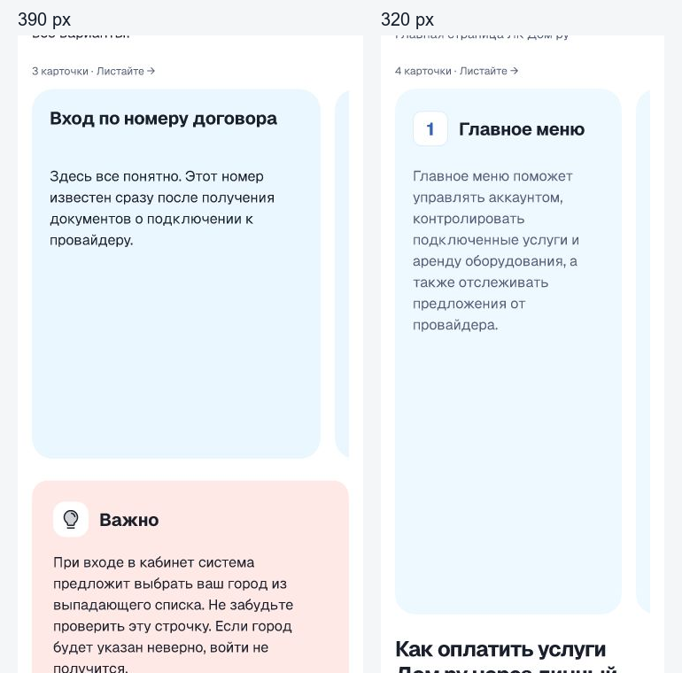

# Личный кабинет: мобильные ленты без переключателей

05.11.2026. [Задача #508](https://github.com/Celtoman/astro-telekom/issues/508), продолжение [проверки плеера #506](2026-11-05-account-player-verification.md). **MOBILE_APPLIED / PLAYER_SCROLL_PASS / DESKTOP_TABLET_UNCHANGED / UNPUBLISHED**.

По уточнению владельца цифровые переключатели убраны из актуальных мобильных экранов. Оставлены горизонтальные ленты, количество карточек и подсказка «Листайте →». Упрощение устраняет из пользовательского сценария неисправные кнопки [#507](https://github.com/Celtoman/astro-telekom/issues/507); это не утверждение, что прежние кнопки исправлены.

## Актуальные экраны

- [Mobile 390](https://www.figma.com/design/AcPPCDVqYqZIUJ0GXZVlHj?node-id=118-2109): высота 17992.14 → 17712.14 px.
- [Mobile 320](https://www.figma.com/design/AcPPCDVqYqZIUJ0GXZVlHj?node-id=118-3096): высота 19881.79 → 19601.79 px.

На каждом размере скрыты пять рядов `CAR / Переход к карточке` локальными переопределениями видимости в связанных экземплярах. Auto Layout убрал по 56 px на ряд, суммарно 280 px на страницу. Узлы сохранены, контент карточек и оригиналы блоков не редактировались. Прямой readback десяти рядов подтверждает `visible=false`: [IDs и состояние](evidence/2026-11-05-account-mobile-swipe/hidden-controls.json). Типографика, изображения, ссылки, оглавление и FAQ не менялись.

В начале работы была проверена гипотеза локальных целей. Plugin API отклонил destinationId вложенного экземпляра. В изолированной копии кнопка 2 с физической целью отработала в плеере (X=342, Y страницы сохранён). После уточнения владельца этот вариант не используется: экспериментальные копии 214:3852 и 218:4526 переименованы в «АРХИВ / Проверка кнопок…» и скрыты. Актуальными остаются исходные экранные IDs выше; Desktop и Tablet не затронуты.

## Проверка в реальном плеере

Авторизованный Codex/IAB, окно 1280×720, прототипы в натуральной ширине 390/320. Ввод: реальные горизонтальное/вертикальное колесо и drag мышью; JavaScript только считывал DOM-позиции. Проверены вход, восстановление, возможности, верхнее меню и области главной страницы.

| Проверка | 390 px | 320 px |
| --- | ---: | ---: |
| Доступны все карточки | 18/18 | 18/18 |
| Переходы прокруткой к следующим карточкам | 13/13 PASS | 13/13 PASS |
| Возврат к первой карточке | 5/5 PASS | 5/5 PASS |
| Drag меняет X без изменения Y страницы | 5/5 PASS | 5/5 PASS |
| Вертикальное колесо над лентой меняет Y без изменения X | 5/5 PASS | 5/5 PASS |
| Цифровые кнопки в доступном дереве плеера | отсутствуют | отсутствуют |

[Лог фактического ввода и позиций](evidence/2026-11-05-account-mobile-swipe/runtime-log.json). Вертикальная независимость проверялась на краю ленты после завершения инерции. Первое и последнее состояния и возврат сохранены для всех десяти лент. Обычный режим без Adapt content for screen readers дополнительно проверен на ленте входа 390 и обзоре главной 320: последняя карточка открывается, возврат к первой работает. Временная настройка возвращена в исходное выключенное состояние, вкладка плеера закрыта.

С `interaction-design` проверены достижение результата и возврат, с `web-accessibility` — наблюдаемая альтернатива горизонтальному drag через колесо и разделение направлений ввода. Физический сенсорный экран, мобильные Safari/Chrome, клавиатура и скринридер не тестировались; соответствие WCAG не заявляется. Автоматическая доводка к карточке остаётся ранее записанным отдельным UX-наблюдением, её реализация не входила в поручение.

## Сохранность и доказательства

Отпечатки выбранных свойств всех узлов Desktop и Tablet совпадают до/после: Desktop `7b929875`, 679 узлов; Tablet `f42d2880`, 677 узлов. Совпали размеры, структура, тексты, стили, заливки, layout и реакции в проверяемом наборе полей: [до](evidence/2026-11-05-account-mobile-swipe/baseline.json), [после](evidence/2026-11-05-account-mobile-swipe/final-snapshots.json). Это структурная проверка неизменности, а не новый визуальный аудит принятых раскладок.

[Кадры и SHA-256](evidence/2026-11-05-account-mobile-swipe/exports.json). Код/CMS/Screens и публикация библиотеки не менялись. README и регламент актуальны; результат добавлен в PF-171. Пользовательские исследовательские сессии не проводились, новая визуальная приёмка владельца отдельно не получена.
