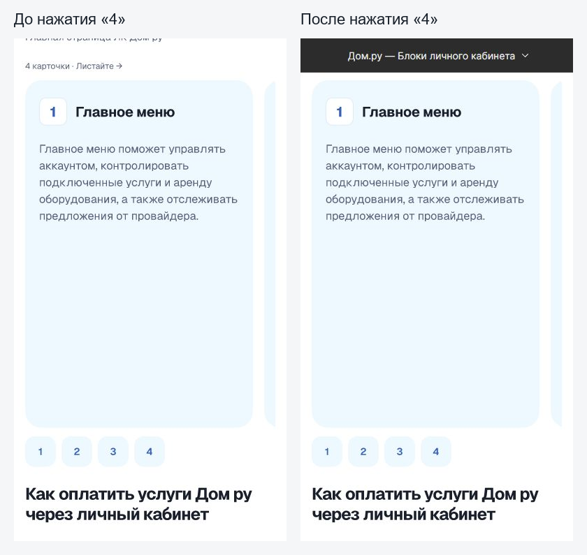

# Личный кабинет: проверка мобильных лент в плеере

05.11.2026. Проверка [#506](https://github.com/Celtoman/astro-telekom/issues/506), продолжение [#505](2026-11-05-account-mobile-rails-figma.md). **SCROLL_PASS / BUTTONS_FAIL / FIX_PENDING**. Дефект зарегистрирован отдельно: [#507](https://github.com/Celtoman/astro-telekom/issues/507). Макеты и переходы в этой проверке не редактировались.

Проверены [Mobile 390](https://www.figma.com/proto/AcPPCDVqYqZIUJ0GXZVlHj?node-id=118-2109&starting-point-node-id=118%3A2109&scaling=scale-down-width) и [Mobile 320](https://www.figma.com/proto/AcPPCDVqYqZIUJ0GXZVlHj?node-id=118-3096&starting-point-node-id=118%3A3096&scaling=scale-down-width) в авторизованном браузере Codex/IAB. Авторизация Figma в Codex оказалась достаточной; повторный вход в Chrome не требовался.

## Результат

| Проверка |390|320|
|---|---:|---:|
| Ленты / карточки |5 /18|5 /18|
| Переходы горизонтальной прокруткой к следующим карточкам |13/13 PASS|13/13 PASS|
| Возврат прокруткой к первой |5/5 PASS|5/5 PASS|
| Горизонтальный drag без вертикального сдвига |5/5 PASS|5/5 PASS|
| Вертикальная прокрутка над лентой сохраняет её X |5/5 PASS|5/5 PASS|
| Кнопки: ожидаемая позиция трека в основном прогоне |0/18 FAIL|0/18 FAIL|

[Сводка](evidence/2026-11-05-account-player-verification/summary.json) и [фактические действия/позиции](evidence/2026-11-05-account-player-verification/runtime-log.json). Проверены вход, восстановление, возможности, верхнее меню и области главной страницы. Через горизонтальную прокрутку доступны все 36 карточек, включая последние; все 10 лент возвращаются к X=0. При 26 переходах горизонтальной прокруткой вертикальная позиция не менялась. В отдельных пробах drag ещё продолжал инерционное движение на 2 px; вертикальная независимость дополнительно проверена после достижения края трека: Y изменяется на 72 px, X остаётся прежним.

Кнопки не прошли проверку. Основная матрица содержит 36 реальных физических нажатий по видимым цифровым кнопкам: 2–N из начального состояния и 1 после достижения последней карточки. Измерение позиции выполнено после события и чтения состояния плеера. Отдельный контроль в обычном режиме без Adapt content for screen readers с ожиданием установившегося результата подтвердил отсутствие перехода: на 390 после 1200 ms сохранённый снимок всё ещё показывает первую карточку после нажатия 4; на 320 переход 4 не открыл последнюю карточку, а 1 после листания к последней не вернул первую. Общий вывод — кнопки нельзя принять как рабочий способ навигации. В отдельных вызовах getScreenshot появлялась чёрная область, тогда как соседний сохранённый browser.screenshot показывал содержимое; нестабильные захваты не используются как доказательство дефекта отрисовки.

## Метод и границы

Браузер 1280×720, прототипные экраны 390 и 320, Fit width с натуральной шириной макета; внешние чёрные поля относятся к плееру. Использованы реальные перемещения указателя, нажатия, горизонтальное колесо и вертикальное колесо над карточкой. `scrollLeft`/`scrollTop` читались из стандартных DOM-областей доступного представления плеера. Значения прокрутки через JavaScript не устанавливались, реакции через Plugin API не запускались. Физический сенсорный экран, мобильные Safari/Chrome и соответствие WCAG/AT этой проверкой не подтверждаются.

После нативного drag лента может остановиться между карточками; автоматической доводки в проверенных состояниях не наблюдалось. Это отдельный UX-вопрос для обсуждения; прежний контракт привязки при реализации сайта не является доказательством такой функции в Figma.

Основная матрица выполнена с временно включённым Adapt content for screen readers для считывания позиций. Настройка возвращена в исходное false, [подтверждение](evidence/2026-11-05-account-player-verification/restored-player-settings.json). Обычный режим проверен отдельно по сохранённым кадрам. Временная вкладка плеера закрыта. Закрытие Inline Preview во встроенном MCP-просмотре не удалось подтвердить; это не изменение файла дизайна.

## Причина и следующий шаг

[Свежая сверка 36 целей](evidence/2026-11-05-account-player-verification/button-targets.json) показывает: SCROLL_TO унаследован от оригиналов и указывает на реальные узлы страниц 47:4/47:5/47:8/47:9; соответствующие карточки выбранного экрана имеют другие, вложенные IDs. **Гипотеза причины** — некорректное разрешение цели в контексте экземпляра. Наличие валидного destinationId в API не доказало работу перехода в Present. Окончательно причина подтверждается исправлением и повторным прогоном.

Предлагаемое исправление #507: настроить цели внутри действительного прототипного экрана. Если API не принимает IDs вложенных экземпляров, создать отдельные прототипные оболочки 390/320 с локальными областями прокрутки и целями, сохранив исходную сборку, оригиналы и связанные UI-компоненты. Затем повторить 36 кнопок, 26 переходов прокрутки и 10 возвратов. Исправление в текущую проверку не входило и не применялось.

Экспертная проверка interaction-design/web-accessibility относится к управлению жестом, альтернативным кнопкам и разделению направлений. Пользовательские сессии не проводились. Принятые Desktop/Tablet, исходные мобильные макеты, CMS, код, Screens и публикация библиотеки не затронуты. README и регламент актуальны. PF-171 дополнен результатом и наблюдением о доводке. [Нативные кадры и SHA-256](evidence/2026-11-05-account-player-verification/exports.json) сохранены; сравнение — только обрезка исходных кадров до/после.
