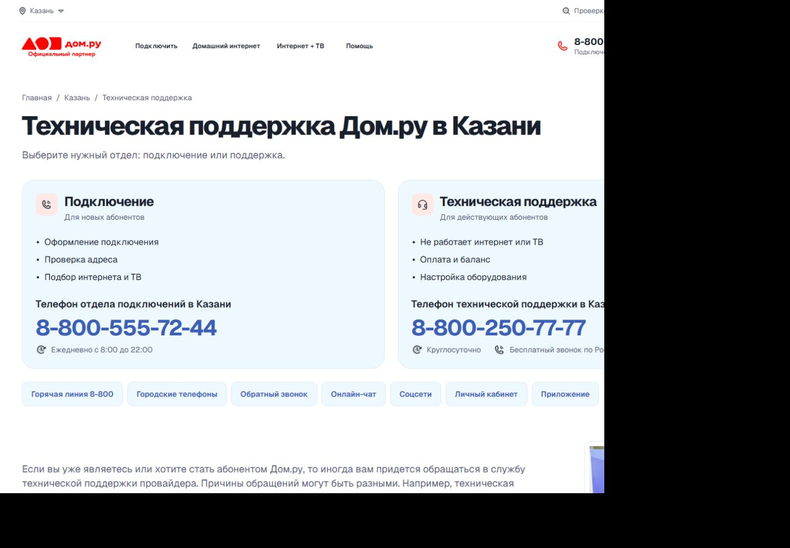

# Перенос CITY_SUPPORT в код и CMS

Городская поддержка выпущена в защищённом тестовом контуре для 207 городов. Финальная проверка выполнена для `703df070`, CMS 34. Источник композиции — четыре утверждённых экрана Screens 620:43710 / 43728 / 43746 / 43764. [Задача #611](https://github.com/Celtoman/astro-telekom/issues/611), [контракт редактора](../plans/2026-11-17-support-cms-contract.md), [технический контракт](../support-page.md).

## Сохранность источника

Согласованные исправления выполнены в профильных Figma-семействах и Screens до переноса. Полный телефонный снимок и выноска сохранены; изменение порядка секций сдвинуло только корни. Отдельный protected audit содержит геометрию, текст и ссылки исходников.

Автоматическая сверка 145 текстовых фрагментов не нашла потерь: исключены общие Header/Footer/AddressOnly и служебные ответы FAQ; согласованные переменные разрешены в пример Казани. 38 assets, включая 14 полностью декодированных растров, совпали по SHA и размерам. У приложения исправлено расширение на `.jpg` по реальному JPEG-формату, байты сохранены. [Доказательства](evidence/2026-11-17-support-implementation/figma/assets-integrity-audit.json), [сверка текста](evidence/2026-11-17-support-implementation/copy-proof.json).

## CMS и данные

Встроенный браузер Codex, собранная admin fixture и собственная PostgreSQL подтвердили ручное сохранение rich-text, выделение и typed link, вставку переменной в обычный и форматированный текст, настоящий file chooser/upload, выбор области номера, сохранённый preview и доступ к private full/crop. FAQ: добавление, заполнение, перестановка и удаление собственного тестового вопроса. Неполная пара сохранилась как draft с точными недостающими полями. После stale409 введённый H1 остался в форме. Все испытания использовали синтетический сайт; затем его content восстановлен из начальных defaults.

SQL rehearsal проверил fresh seed, working-only backfill, повтор без перезаписи, provider isolation, сохранность прочих Page/PageTemplate и historical publication, optimistic save, неполный draft, all-city preflight и rollback коллизии. Дополнительно авторский CITY_HOME ответ с `[ссылка](account)`, звёздочками, обратной косой и переменной скопирован как буквальный текст: markdown не возник из исходного простого ответа.

HTTP rehearsal подтвердил cookie guard, настоящий PNG multipart, подготовку crop, captured media, единый asset полного снимка/выноски, фактические SHA/размеры приватных WebP, отказ некорректной области, чужому сайту, неизвестному variant, подмене src и устаревшей ревизии. [Протокол HTTP](evidence/2026-11-17-support-implementation/http-proof.json).

## Визуальная и интерактивная проверка

Применены критерии astro-design-review: сохранение принятой композиции, иерархия, поверхности, библиотечные основы, адаптивы и раздельная фиксация статического макета/живого поведения. Витрина использует проектные Geist, общие Header/Footer/AddressOnly/FAQ и исходные брендовые assets. Новая дизайн-система не вводилась.

IAB проверен на 1440/834/390/320 и 621/768/1101 px. Документ не получил горизонтального переполнения; 15 px системной вертикальной полосы Windows уменьшают фактическую ширину содержимого, карточки растут по тексту. На 320 телефонный номер помещается в строку. Ранний локальный вывод о магазинах 2+1 оказался недостаточным: внешний JSONB-снимок изменил порядок бейджей, см. #613 ниже. На320 остаются три строки; планшетный чат центрирован, карточки ограничений ПК — 2×2. Низ телефонов показывает полный 697×519 источник и увеличенный фрагмент того же файла.

Мобильные чипы имеют два ряда, внешний размер 32 px, gap8, viewport72 и track599. Три карточные области используют нативный горизонтальный overflow. Клавиатура довела ленту компетентности до второй карточки (`scrollLeft=295`), видимая рамка фокуса 2 px; вертикальный ввод внутри ленты сдвинул страницу на450 px, сохранив scrollLeft и нулевой root scrollX. Это desktop IAB с эмуляцией размеров и нативными wheel/keyboard, не физический touch, AT или полный WCAG-аудит.

## Проверки перед первым выпуском

До первого выпуска рабочая и опубликованная ревизии совпадали (33/33). Рабочих изменений не было. Во всех 207 городах нашлись тарифные данные для ответов FAQ. [Протокол состояния до выпуска](evidence/2026-11-17-support-implementation/live-before.json).

Ранние прогоны прерваны системной нехваткой памяти Windows; отдельный HOME build при повторе прошёл. Эти попытки не считаются зелёным gate. После исправления устаревшего ожидания seed итоговый `pnpm check --test-concurrency=2` на Node24 завершился с exit0. Rust/Go workers ограничены двумя; новые и прежние SQL/HTTP/Astro/Caddy сценарии прошли. Числа и checksum проверенного runtime patch — в [протоколе gate](evidence/2026-11-17-support-implementation/local-gate.json).

Независимая находка [#612](https://github.com/Celtoman/astro-telekom/issues/612) об official-site группе паспортов зафиксирована отдельно; внутри переноса поддержки не исправляется.

## Первый внешний выпуск и корректировки приёмки

`f114518a3fe559d0391a83d7b29d44dfa8593105` прошёл exact-SHA Linux CI44097798216:1155pass/0fail/0skip. Coolify MCP deployment `bhsgfotbnmedykn5iyjkvgsw` finished/exact SHA/running:healthy. CODE после ответов202 подтверждён SUCCEEDED и сохранил publication33/catalog digest. Повторялось то же идемпотентное действие, новый deployment не создавался.

Полный review показал единственное изменение `migration:0076:support`, PASSED/4450URL. Тарифы, общие и другие городские страницы, редакционный контент и старые маршруты сохранились. CMS publication `cmwksjwbj000801p5xf2gqcx5` активирован 17 ноября в14:37:14UTC:34/34, rebuild37 SUCCEEDED, private receipt отражён в SQL acknowledgment. Все207 SUPPORT HTML и38 исходных assets прошли HTTP/SHA-проверку. Сравнение сохранности использует структурное равенство JSON: порядок ключей JSONB не является изменением данных.

Встроенный браузер получил ERR_INVALID_AUTH_CREDENTIALS. После явного разрешения владельца использован фоновый Chromium с origin-scoped HTTP credentials и обычной проверкой TLS, без видимых окон. Проверены1440/834/390/320, все мобильные чипы/ленты нативными keyboard/wheel и сохранение вертикальной прокрутки. Это эмуляция размеров и ввода, не физическое устройство.

Первый внешний аудит выявил две ошибки. Порядок ключей JSONB менял якоря, магазины и карточки. Инициализация rich-text блокировала ссылку на предпросмотр из-за ложного признака несохранённых изменений. В `703df070` порядок элементов задан явно, а переключение доступности поля происходит без события изменения. [#613](https://github.com/Celtoman/astro-telekom/issues/613), [#614](https://github.com/Celtoman/astro-telekom/issues/614).

Локальный повторный полный gate:1156tests/1155pass/0fail/1Windows-symlinkskip. Последнее исправление editable отдельно прошло admin lint/build; затем Chromium получил локальные static files новой сборки и только читал API защищённой test-CMS. Чистое открытие редактора и переход к saved preview без сохранения подтверждены, pageerror0. Это проверка кандидата, а не уже развёрнутой новой админки. [Gate](evidence/2026-11-17-support-implementation/order-fix-local-gate.json), [кандидат CMS](evidence/2026-11-17-support-implementation/admin-candidate.json), [наблюдения первого выпуска](evidence/2026-11-17-support-implementation/initial-browser-findings.json).

## Финальная приёмка 17 ноября

Linux CI прошёл 1156 тестов без падений и пропусков для `703df070c25b08a56c11b5e400c994994d6e102e`. Coolify завершил развёртывание `ihaqrzspx5qzfcg2rdfe69ki` с тем же SHA, приложение в состоянии `running:healthy`. CODE вернул `SUCCEEDED` и сохранил идентификатор CMS-публикации `cmwksjwbj000801p5xf2gqcx5`, ревизию 34 и digest каталога. Живой HTML подтвердил новый артефакт `c2a06cf30efb26ded096dd2075b8b5314d266acc235de4543d6d660d4eadf239`. [CI](evidence/2026-11-17-support-implementation/ci.json), [развёртывание](evidence/2026-11-17-support-implementation/deployment.json), [квитанция CODE](evidence/2026-11-17-support-implementation/code-release.json), [квитанция CMS](evidence/2026-11-17-support-implementation/cms-release.json).

В защищённом контуре все 207 страниц поддержки вернули HTTP 200. Проверены городские переменные, canonical, sitemap, Basic Auth, noindex и SHA-256 всех 38 файлов. Каталог содержит 4450 маршрутов, из них 4243 существовали до выпуска. Тарифы, остальные страницы и редакционный контент совпали по структуре и значениям. HTML блока телефонов совпал с версией до исправлений после нормализации префикса версии файлов. Полный снимок и увеличение загрузились из одного источника. [HTTP-проверка](evidence/2026-11-17-support-implementation/live-smoke.json), [сверка телефонов](evidence/2026-11-17-support-implementation/protected-phone-final.json).

В фоновом Chromium проверены четыре ширины. На каждой сработали семь якорей и раскрытие FAQ клавишами Enter и Space. На 390 и 320 px у чипов два ряда высотой 32 px в области 72 px. Чипы и три карточные ленты прокручиваются по горизонтали, вертикальный ввод прокручивает страницу. На 390 px магазины расположены 2+1, на 320 px идут в три строки. На планшете совпадают высота карточек компетентности и начало их описаний, снимок чата центрирован. Переход Казань → Самара сохранил раздел поддержки. Проверка ввода выполнена клавиатурой и колесом в эмуляции ширин. [Отчёт Chromium](evidence/2026-11-17-support-implementation/browser/live-browser.json).

Редактор внешней CMS открылся без признака несохранённых изменений и показал сохранённый предпросмотр Абинска. В рабочей и опубликованной ревизиях совпали поля и шесть ответов FAQ. В браузерной проверке использовалось чтение сохранившихся данных. Сценарии сохранения, загрузки и конфликта ревизий проверены на изолированных данных. [Проверка CMS](evidence/2026-11-17-support-implementation/browser/admin-proof.json), [итоговая опись](evidence/2026-11-17-support-implementation/acceptance.json).

Снимки всей страницы — [1440 px](evidence/2026-11-17-support-implementation/browser/support-1440-full.jpg), [834 px](evidence/2026-11-17-support-implementation/browser/support-834-full.jpg), [390 px](evidence/2026-11-17-support-implementation/browser/support-390-full.jpg) и [320 px](evidence/2026-11-17-support-implementation/browser/support-320-full.jpg). Для страницы на 320 px масштаб записи снимка уменьшен до 75% при сохранении ширины вёрстки, чтобы Chromium захватил весь футер. [Футер 320 px](evidence/2026-11-17-support-implementation/browser/support-320-footer.jpg).

Предыдущий обслуживавшийся артефакт CMS 34 — `9cc5c8e2c2977be7354ed3430a452d13162d9dc663892a17183cc5845bdbc2ed`. Артефакт до CMS 34 зафиксирован вместе с идентичностью снимка 33. При необходимости оператор сверяет доступность артефакта и его опись по правилам хранения. При архивировании HTML оператор возвращает файлы через private restore. Для изменения опубликованного контента требуется новый проверенный снимок с новой последовательностью выпуска. Откат внешнего контура в ходе приёмки не выполнялся. [Базовое состояние](evidence/2026-11-17-support-implementation/prepublication.json), [порядок восстановления](../runbooks/publication-retention.md).

В исходнике Figma сохранён пробел внутри слова «для». Его редакционное исправление отслеживается отдельно. [#615](https://github.com/Celtoman/astro-telekom/issues/615).
