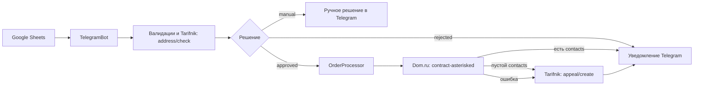

# API обработки заявок в текущем `domru_smart_bot`

Дата исследования исходного кода: 7 сентября 2026 года.

Целевые отличия новой платформы обновлены по согласованным решениям 10 сентября 2026 года.
Статус: фактический срез исходного кода; поведение бота само по себе не является контрактом для новой платформы.

## Область исследования

Изучен исходный код `D:\01 vibecode\domru_smart_bot` и его актуальная документация. Внешние API не вызывались, реальные заявки, логи, `.env` и файл сервисного аккаунта не читались. Поэтому ниже отделены подтвержденное поведение кода, зависящие от окружения детали и неизвестные.

## Подтвержденный маршрут заявки

1. Бот читает все вкладки Google Sheets c правом только на чтение, получает записи целиком, приводит `ID` к строке, сортирует по убыванию и берет ограниченное число свежих строк. Источник: `D:\01 vibecode\domru_smart_bot\bot.py:2707-2775`.
2. В холодном запуске и при отсутствии сохраненного последнего ID исторические строки не обрабатываются: текущая верхняя строка становится baseline. Это подтверждается и регрессионными тестами. Источники: `bot.py:3864-3959`, `tests/regression/test_order_state_guard.py:58-95` в исследованном репозитории.
3. Для новой строки извлекаются телефон, IP, User-Agent и адрес. Сначала применяются приоритетные фильтры; затем параллельно валидируются телефон и IP, после этого адрес. Если адрес допускает несколько вариантов, обработка останавливается до ручного выбора в Telegram. Источник: `bot.py:4018-4110`.
4. При валидном адресе бот вызывает **Tarifnik**, а не Dom.ru, для проверки доступных провайдеров: `POST https://dealers-api.tarifnik.ru/api/v3.0/address/check` c Bearer-токеном и объектом `suggestion`. Источник: `bot.py:1661-1702`.
5. Заявки получают решения `approved`, `rejected`, `manual` либо `api_failure`. Только `approved` передается в `OrderProcessor`; остальные пути создают Telegram-уведомление или ручное решение. Источник: `bot.py:4120-4224`.
6. Если API проверки провайдеров вернул хотя бы одного провайдера, `OrderProcessor` в любом случае запускает проверку Dom.ru — даже когда в ответе нет названия «Дом.ру». Если список пуст, возвращается результат `no_providers` без отправки в Tarifnik. Источники: `order_processor.py:85-129`, `order_processor.py:391-407`.
7. Проверка Dom.ru — это проверка контракта по телефону, а не проверка покрытия: `GET https://web-api.dom.ru/api-profile/v1/unauth/contract-asterisked` с параметрами `contact` и `isActive`. Для запроса подбираются заголовки города из локального `cities.csv`; номер приводится к формату `7XXXXXXXXXX`. Источник: `city_api_client.py:15-76,93-138,140-206`.
8. Непустой массив `contacts` в ответе Dom.ru дает исход `domru_found` и не передает заявку в Tarifnik. Пустой `contacts`, недоступный город или ошибка Dom.ru переключают сценарий на Tarifnik. Источник: `order_processor.py:176-314`.
9. Передача во внешний кол-центр реализована как `POST https://dealers-api.tarifnik.ru/api/v3.0/appeal/create`. В полезную нагрузку попадают фиксированный `utm_campaign = "Domru"`, нормализованный телефон, адресная `suggestion` и `belong_type = "apartments"`. Код считает успешным только HTTP 200, сохраняет `appeal_id`, если он пришел в ответе. Источник: `tarifnik_client.py:15-34,125-279`.
10. Текущая защита от дублей действует только по нормализованному телефону, живет в памяти процесса 24 часа и не использует адрес. Локальный дубль не делает HTTP-вызов; ответ Tarifnik `created_duplicate` помечается как серверный дубль. Источник: `tarifnik_client.py:49-123,147-171,230-249`.
11. В коде есть повторные попытки отправки **Telegram-уведомлений** (четыре попытки, поскольку цикл идет от 0 до 3). В методе отправки в Tarifnik виден один HTTP POST с таймаутом 30 секунд и обработкой ошибок; собственный цикл повторной отправки туда не добавлен. Источники: `bot.py:4287-4329`, `tarifnik_client.py:211-279`.

## Что зависит от окружения

| Параметр | Подтвержденное условие в коде | Значение для новой платформы |
|---|---|---|
| Источник лидов | Нужны `SPREADSHEET_ID` и Google credentials; Google Sheets является read-only источником. Источники: `config/settings.py:49-123`, `bot.py:2720-2729` в исследованном репозитории. | Новый сайт не должен зависеть от таблицы: сохранять лид до передачи во внешнюю CRM. |
| Токен и адрес Tarifnik | Нужен `TARIFNIK_TOKEN`; адрес API и кампания зашиты в клиенте. Источники: `config/settings.py:70-123`, `tarifnik_client.py:18-22`. | Вынести в адаптер внешней CRM с настройками на уровне сайта/провайдера. |
| Dom.ru-проверка | Заголовки `origin`, `providerid` и `referer` берутся из `cities.csv`; город ищется с нормализацией и fallback. Источник: `city_lookup.py:19-42,95-160`. | Хранить эти технические параметры отдельно от публичной карточки города и не показывать их редактору без необходимости. |
| Оповещения | Получатели Telegram задаются `NOTIFICATION_CHAT_IDS`; если настройка отсутствует, применяется fallback-логика авторизованных чатов. Источник: `docs/CONFIG_REFERENCE.md:7-16`. | Канал уведомлений не доказывает доставку лида в кол-центр; в журнале заявки нужны разные статусы. |

## Существенные различия с целевой системой

- Бот не реализует постоянный журнал заявок, очередь повторной отправки или историю попыток во внешнюю CRM: его состояние и ручные решения находятся в runtime-файлах `data/`, а передача в Tarifnik использует только кэш памяти процесса. Источники: `docs/SYSTEM_OVERVIEW.md:54-59`, `tarifnik_client.py:31-34` в исследованном репозитории.
- Согласованное правило новой платформы — подавлять дубликаты по телефону **или** нормализованному адресу на 24 часа и сохранять их со статусом «Дубликат: не передана». Это шире текущей логики бота и требует новой персистентной модели.
- Поля, нужные в новой карточке заявки — реферер, время на сайте, форма, путь посетителя, UTM, исходный URL и результат проверки адреса — не являются частью тела запроса `appeal/create`, найденного в боте. Их нужно сохранять до вызова адаптера.
- Проверенный принцип бота сохраняется: если Tarifnik `address/check` вернул хотя бы одного провайдера, проверка действующего абонента Дом.ру выполняется независимо от наличия Дом.ру в списке. При этом delivery в CRM разрешается только если среди провайдеров найден Дом.ру и проверка абонента дала однозначный отрицательный ответ; при полном отсутствии провайдеров contract check не запускается.
- Fallback бота при ошибке API Дом.ру в новую платформу не переносится. Только успешный ответ ожидаемой структуры с явным пустым массивом `contacts: []` означает «действующий абонент не найден»; вместе с подтвержденным наличием Дом.ру это разрешает `appeal/create`. Timeout, HTTP/сетевая ошибка, HTML, невалидный JSON, отсутствие или неверный тип `contacts`, неизвестная структура, неопределенный город и отсутствующая конфигурация требуют ручной проверки без автоматической передачи.
- Для публичного сайта согласованы два flow: обычная форма скрывает все проверки и всегда отвечает коротким подтверждением, а видимая проверка подключения сначала показывает результат адреса и просит телефон только при найденном Дом.ру. Бот не является источником UX для этих форм.
- В новую платформу без потери строк перенесен полный UTF-8 `cities.csv`, а не только профиль Казани: 555 строк помещены в версионированный asset, точные повторы сведены при загрузке к 551 уникальной паре «регион + населенный пункт», сохранены 37 явных региональных fallback. В отличие от bot lookup, одинаковые названия в разных регионах не перезаписывают друг друга: профиль выбирается по нормализованным данным DaData.
- Retry бота не копируется. Платформа повторяет `appeal/create` только после сети/таймаута, HTTP 408, 425, 429 или 5xx; постоянные 4xx и неоднозначные 2xx сразу переходят в ручной email fallback. Tarifnik не предоставляет callback и отдельный idempotency key, а сохраненный дубль подтверждает ответом `created_duplicate`.

## Неизвестно без доступа или отдельного теста

1. Правомерность использования приватного/неофициального endpoint Dom.ru для нового продукта и стабильность контракта во всех городах. Пустой и непустой `contacts` подтверждены живыми probes для Казани и Набережных Челнов соответственно.
2. Какие поля из `suggestion.data` принимает или игнорирует Tarifnik, и можно ли передать источник, UTM, страницу, тариф, тип объекта и метаданные поведения.
3. Дополнительные договорные rate limit и SLA Tarifnik, если партнер их установит. Публичная спецификация их не содержит; callback отсутствует, дубль сохраняется партнером и возвращается как `created_duplicate`.
4. Срок сырых заявок согласован как 180 дней; отдельно остаются сроки телеметрии, legal basis, согласие и правила передачи PII.

## Последствия для проектирования

1. Оставить существующий бот самостоятельным внешним потребителем: не встраивать его файловое состояние или Telegram-flow в новую админку.
2. Реализовать в новой платформе адаптер внешней CRM с журналом попыток, идемпотентным ключом, явными исходами доставки и повторной отправкой.
3. Разделить два разных факта в карточке заявки: «провайдеры по адресу» (Tarifnik address check) и «действующий абонент Dom.ru» (контракт по телефону); отдельно хранить решение маршрутизации и только реальные попытки передачи.
4. Валидировать ответ Dom.ru строго: непустой `contacts` блокирует передачу, явный пустой `contacts: []` разрешает ее, а любой неразрешимый ответ переводит заявку в ручную проверку.
5. До подключения реальных ключей зафиксировать контракт адаптера на тестовых ответах и провести отдельную проверку согласия/правомерности передачи персональных данных.
